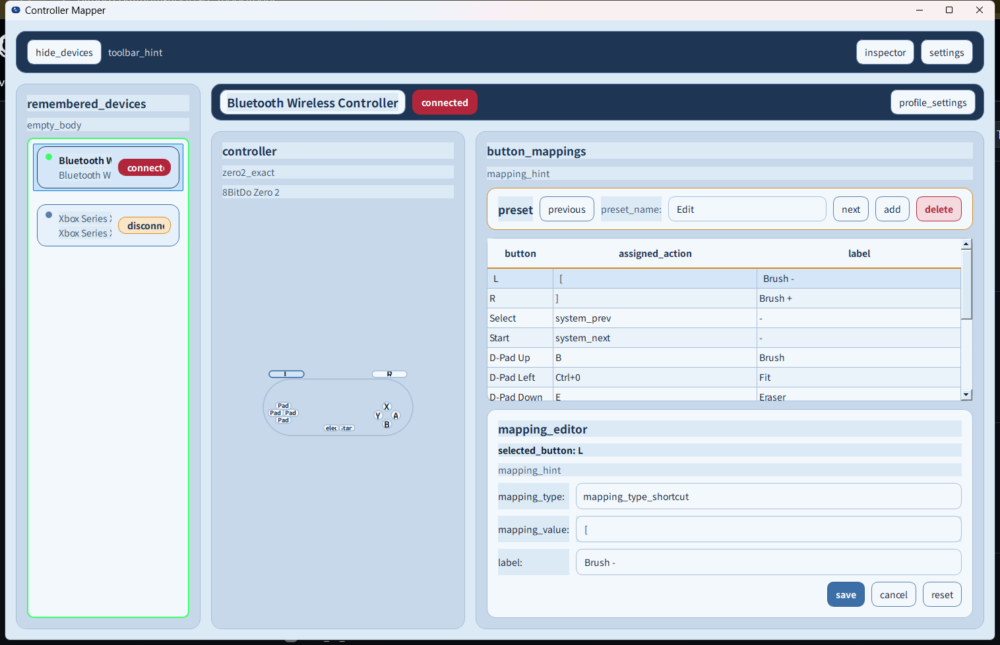
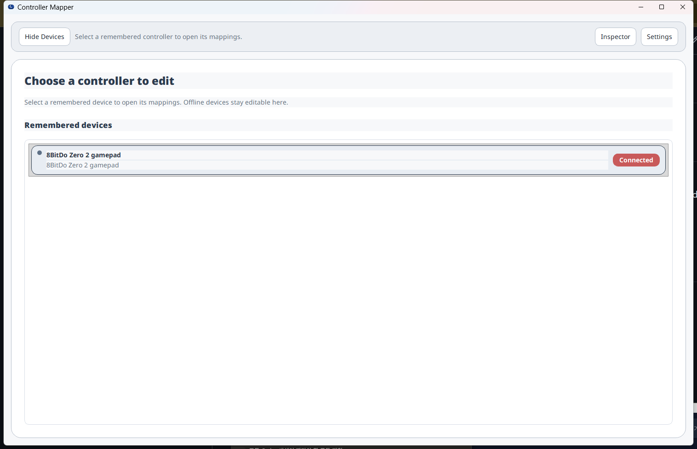
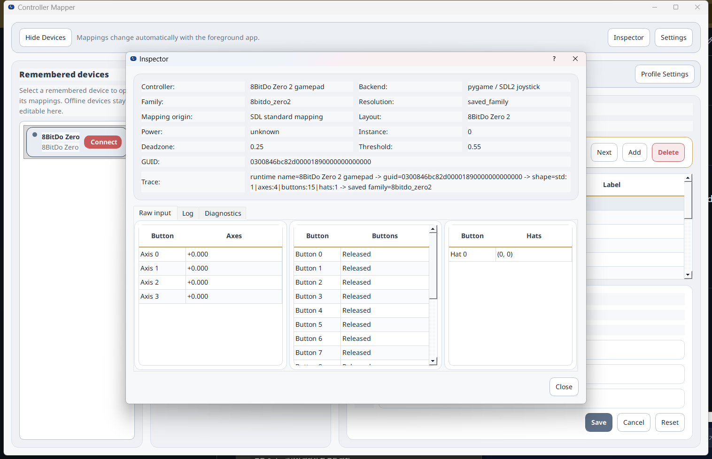
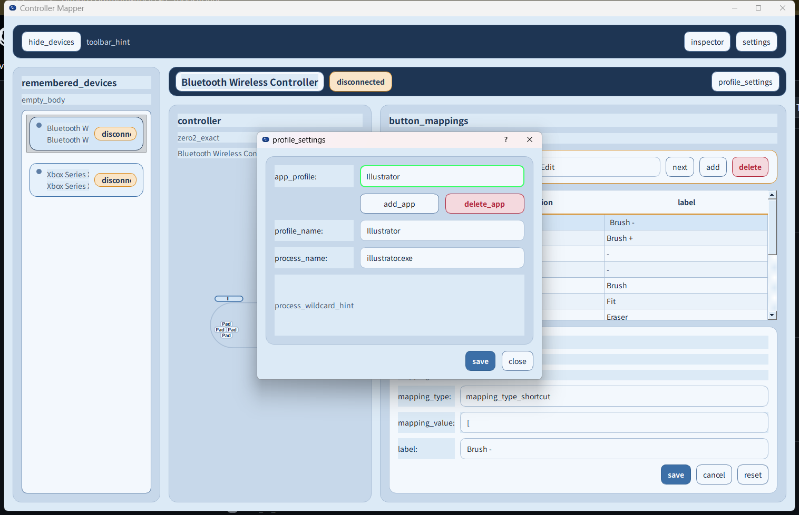

# BBCC

> Windows-first controller mapping for creative shortcuts, desktop navigation, and media control.

[English](README.md) | [한국어](docs/README.ko.md) | [日本語](docs/README.ja.md) | [中文](docs/README.zh-CN.md)



**[Download for Windows](https://github.com/Bum-Boo/BBCC/releases/tag/v0.1.1)** · [How to use](#basic-usage)

BBCC is a Windows-first, tray-resident controller mapping tool for creative workflows, desktop navigation, and media control. It is built for people who want quick controller-driven shortcuts without keeping the main window in the way.

The core concept is:

`Device -> App Profile -> Preset -> Button Mapping`

In practice, BBCC remembers your controller, switches behavior by active app, lets you keep multiple presets per profile, and maps controller inputs to keyboard shortcuts or other actions.

## Safety and privacy

- BBCC runs locally and watches the foreground process name so it can select an app profile.
- Mappings can emit global keyboard or mouse input. Test a new profile in a harmless app before using it in creative work, games, password fields, or any workflow where an accidental shortcut could lose data.
- Stop or exit BBCC before entering sensitive information if a mapping could fire unexpectedly.
- Configuration is stored locally; remove personal process names and shortcuts before sharing logs, screenshots, or configuration files.
- Read [Safety and Privacy](docs/safety-privacy.md) for the full operating boundary.

## Requirements

- Windows
- Python 3.8 or newer for source installation
- A supported controller; current practical coverage focuses on 8BitDo Zero 2 and Xbox/XInput-family devices
- Dependencies from `requirements-dev.txt` for development and local tests

### Key Features

- App-based profile switching by foreground process name
- Per-profile presets for different workflows
- `YouTube` / media fallback profile for general media control
- Offline saved-device editing, so remembered devices stay usable even when disconnected
- Multilingual UI support
- Theme support
- Controller-aware layouts and diagrams
- Inspector and mapping editor for reviewing and adjusting bindings

### Supported Controllers

Current practical support focuses on:

- 8BitDo Zero 2
- Xbox Controller / XInput-family devices

If you want support for another controller model, please open an issue and describe the device. Additional controller support can be requested and discussed there.

### Typical Use Cases

- Creative apps such as Photoshop and Illustrator
- One-handed controller workflows
- YouTube and other media control
- Desktop navigation and shortcut handling

### Basic Usage

Clone the repository, create a virtual environment, install dependencies, and run the app:

```powershell
git clone https://github.com/Bum-Boo/BBCC.git
cd BBCC
py -3 -m venv .venv
.\.venv\Scripts\Activate.ps1
python -m pip install --upgrade pip
pip install -r requirements-dev.txt
python -m zero2_input_inspector
```

### Demo Walkthrough

The demo flow selects the connected `8BitDo Zero 2 gamepad`, reviews the mapping table, checks raw input in Inspector, and opens app-profile settings.

1. Run `dist\BBCC.exe`.
2. Confirm that the controller is shown as `Connected` on the first screen.
3. Click the connected device row.
4. Review shortcut assignments and labels in the `button_mappings` table.
5. Select a button row to edit its shortcut and label in `mapping_editor`.
6. Click `Inspector` in the top-right area to check raw axes, buttons, hats, backend, and GUID values.
7. Open `Profile Settings` to manage fallback and app-specific profiles by process name.

The first screen confirms that the controller is detected and connected. Select the remembered device row to open its mappings.



The mapping view shows the active app profile, button bindings, labels, and the editor panel used to adjust a selected binding.


The `Inspector` button opens live raw input values, including axes, buttons, hats, backend information, and device GUID details.



`Profile Settings` opens the app-profile editor, where fallback and app-specific profiles can be named and matched by process name.



### Known limitations

- BBCC is a Windows-first project
- Browser-based media fallback behavior is part of the broader media workflow
- Layouts and mappings are still being refined
- Some device handling is still evolving as controller coverage expands
- Read [Safety and Privacy](docs/safety-privacy.md) before using global keyboard or mouse mappings in real work.
- Use the [Support Runbook](docs/support-runbook.md) and [Release Checklist](docs/release-checklist.md) for beta testing.

### Feedback / Contribution

Bug reports and pull requests are welcome. If you want support for another controller model, please open an issue and include the device name, what happened, and what you expected.

## Attribution

If you share a fork, demo, article, or derivative, a courteous mention of [@Bum-Boo](https://github.com/Bum-Boo) and the original repository is appreciated. This is a request for credit, not an additional license condition or restriction.
